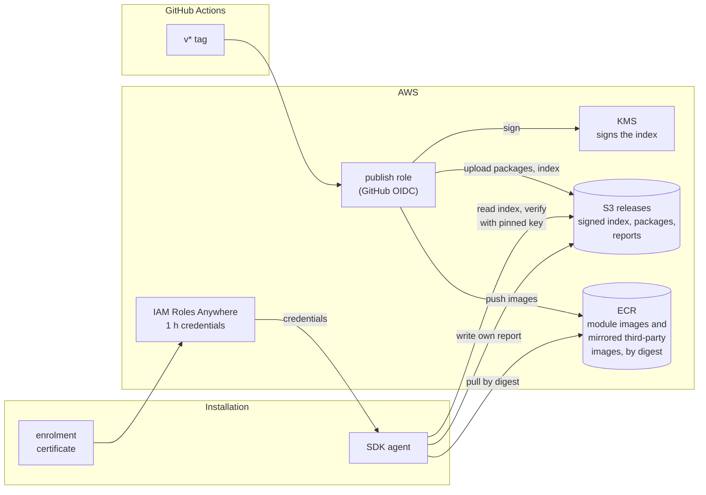
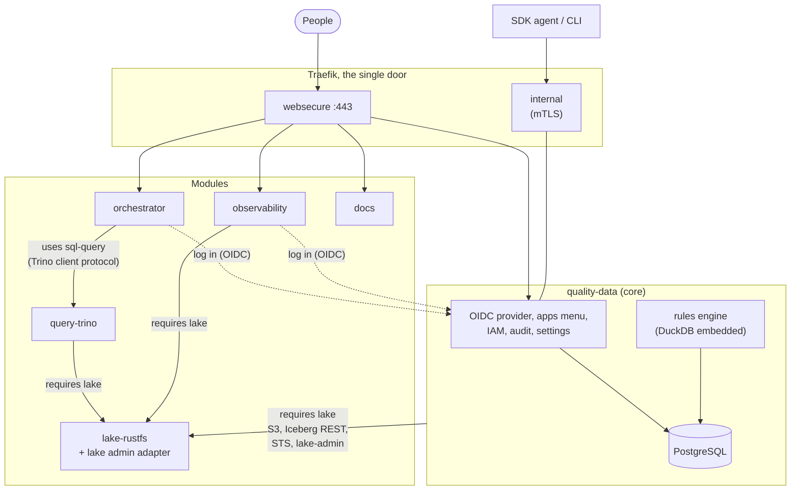

# quality-sdk

quality-sdk installs, configures and updates Quality Data (`quality-data`) and
its modules on local installations, from versions published in AWS. One
installation is one organisation; it may update while its SDK enrolment is
valid.

An installation pulls; nothing is ever pushed to it. Its agent reads a signed
index of versions, checks the signature, pulls the images and packages it
names, backs up, and applies the update as steps that survive a crash. The
installation opens no inbound port for this.

> **Status.** Built: the AWS side in Terraform (`infra/aws/`;
> `infra/test-installation/` for the test server), the pure models of the
> signed index (`crates/index-model`) and of module manifests
> (`crates/module-manifest`), the update engine (`crates/updater`), the agent
> (`crates/agent`: `install`, `run`, `check`) with its adapters for AWS,
> quality-data's internal API, Docker Compose, PostgreSQL and the package
> files, its systemd unit and the server installer (`packaging/install.sh`),
> and the `qsdk` CLI (`crates/sdk-cli`: `enrol`, `sign-enrolment`,
> `revoke`, `publish`). Planned: the module lifecycle
> (`module add|remove|purge`), routes and OIDC clients from manifests, and the
> modules other than `quality-data`.

## Architecture

### Publish and update

The agent then runs the update locally: back up and check the backup, apply
each step with its state written first, verify, and roll back on failure.

### Inside an installation

Solid arrows between modules are capabilities: a module declares what it
provides and what it requires, by name, version and protocol, and the core
never names a module. Module-to-module and agent traffic goes through the
`internal` entrypoint with mTLS. The agent's path through `internal` (mTLS) to
the core is built; the modules and the capabilities between them are planned.

## Principles

- **Pull, not push.** An installation fetches what it needs; no one reaches
  into it.
- **Identity by certificate.** An installation proves who it is with its
  enrolment certificate and gets one-hour AWS credentials. There is no
  long-lived secret, and revoking the certificate stops its updates.
- **Trust by signature.** A version is trusted because the index carries a
  valid KMS signature for the public key the agent pins, not because of where
  the file came from.
- **Updates survive a crash.** Back up first and check the backup; write the
  state before each step; every step can run twice; roll back on failure.
- **Modules are removable.** A module is one folder with its manifest and
  declares what it provides and requires. Removing it keeps its data; only an
  explicit purge deletes data, after a backup.
- **A replaceable lake.** The lake sits behind standard protocols (S3, Iceberg
  REST, STS), so another provider can take its place.
- **Vendor logic as a service.** Vendor-specific logic the core needs reaches
  it as a service behind a versioned protocol, never as linked code.

## Repository layout

| Path                       | What                                                                                                                         |
| -------------------------- | ---------------------------------------------------------------------------------------------------------------------------- |
| `infra/aws/`               | The AWS side in Terraform: S3 releases bucket, ECR, KMS signing key, IAM Roles Anywhere, publish role, module publish roles. |
| `infra/test-installation/` | One EC2 test server, applied and destroyed by a person.                                                                      |
| `crates/index-model`       | The signed version index: model, validation, signature check and rollout. Pure, no I/O.                                      |
| `crates/module-manifest`   | Module manifests: model, validation and capability checks. Pure, no I/O.                                                     |
| `crates/updater`           | The update engine: a state machine that survives a crash, behind its `Host` trait.                                           |
| `crates/agent`             | The installation's agent (`quality-data-agent`) and its adapters.                                                            |
| `crates/aws-client`        | The few AWS calls, signed with SigV4 by hand (no AWS SDK), shared by the agent and the CLI.                                  |
| `crates/sdk-cli`           | The `qsdk` CLI: `enrol`, `sign-enrolment`, `revoke` and `publish`.                                                           |
| `packaging/`               | `install.sh` and the agent's systemd unit.                                                                                   |
| `tools/`                   | `verify/` scripts and `mirror-image.sh`.                                                                                     |
| `.github/workflows/`       | CI checks for Terraform, Rust and shell, and the release binaries.                                                           |

Design records are internal and are not part of this repository.

## Checks

See [AGENTS.md](AGENTS.md), "Checks before a commit", for the commands CI runs
and the build rules on a shared machine.
